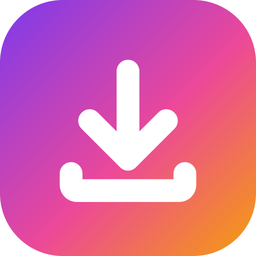
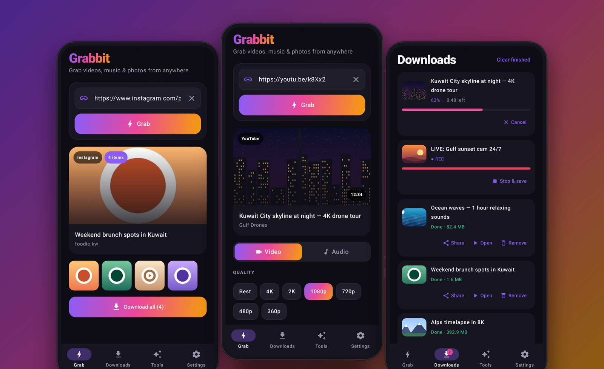
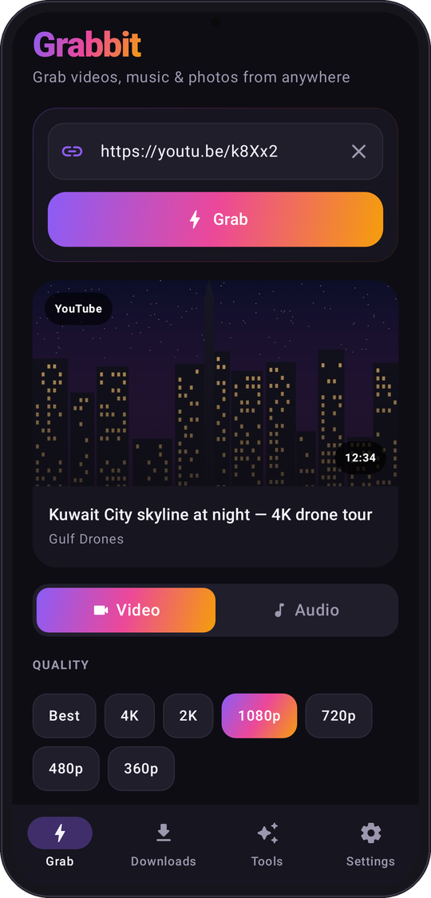
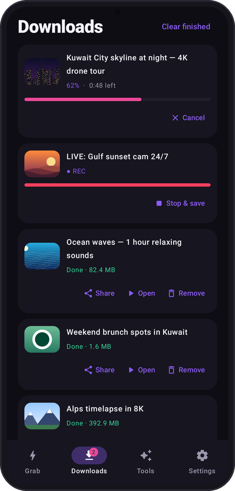
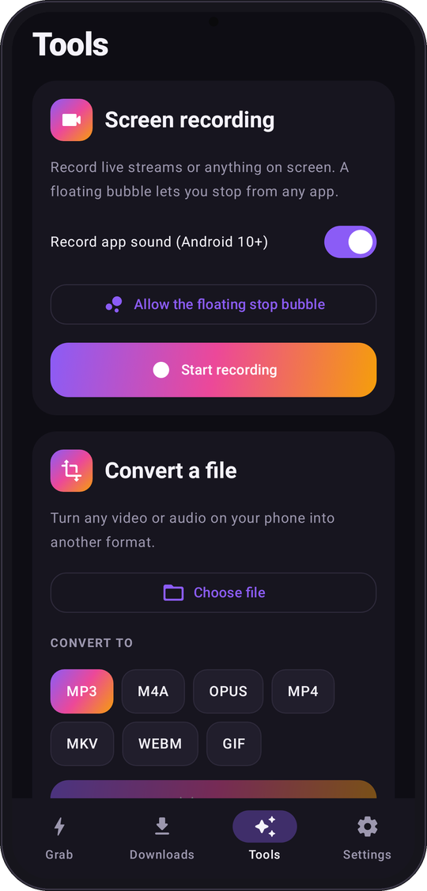
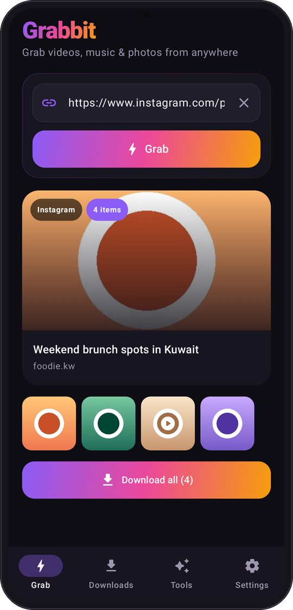
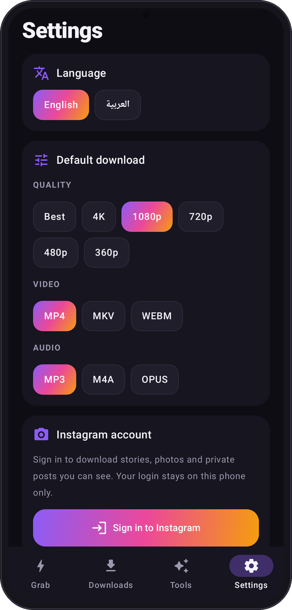
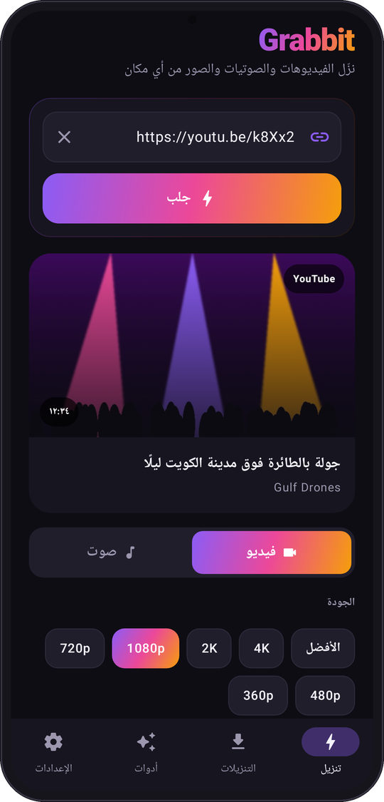

<p align="center">
  
</p>

<h1 align="center">Grabbit</h1>

<p align="center">
  <b>Paste a link. Pick the quality. Grab it.</b><br>
  A free, ad-free video, music and photo downloader for Android. A Snaptube alternative with nothing hidden inside.
</p>

<p align="center">
  <a href="../../releases/latest"></a>
  <a href="../../releases/latest"></a>
  
  <a href="LICENSE"></a>
  <a href="../../stargazers"></a>
</p>

<p align="center">
  <a href="https://github.com/ilukezippo/Grabbit/releases/download/v1.0.0/Grabbit-1.0.0-arm64.apk"></a>
</p>

<p align="center">
  <sub>Downloads the latest APK straight away. Open it on your phone and allow <i>Install unknown apps</i> when Android asks.</sub>
</p>

<p align="center">
  <a href="https://ilukezippo.github.io/Grabbit/"><b>Website</b></a> ·
  <a href="../../releases/latest">All downloads</a> ·
  <a href="#how-to-use">How to use</a> ·
  <a href="CHANGELOG.md">What's new</a> ·
  <a href="#supported-sites">Sites</a> ·
  <a href="#build-from-source">Build</a>
</p>



<p align="center"><sub>If Grabbit saves you time, a ⭐ star on this page helps other people find it.</sub></p>

---

## Why

Most "free" video downloaders for Android are stuffed with ads, trackers and pop-ups, and you can't see what they do with your data. Grabbit does the same job with none of that: it runs [yt-dlp](https://github.com/yt-dlp/yt-dlp) and FFmpeg right on your phone, so the only places your phone talks to are the site you're downloading from and, if you ask, GitHub for engine updates.

## How to use

| Do this | You get |
|---|---|
| In any app, tap **Share → Grabbit** | A quick sheet with the video, its quality choices and a **Download** button, without leaving the app you're in |
| **Copy a link** and open Grabbit | The link is waiting at the top: tap it to look it up |
| **Paste a link** and tap **Grab** | A preview with the picture, title and length, then **Video** or **Audio** |
| Pick **Best, 4K … 360p** and **MP4 / MKV / WEBM** | The video at that quality. Grabbit remembers your choice for next time |
| Pick **Audio** and **MP3 / M4A / OPUS** | Just the sound, at the best quality the site offers |
| Open a **live stream** link | **Record stream**: it keeps recording until you tap **Stop & save** |

Everything is saved to **Download/Grabbit** and listed in the **Downloads** tab, where you can open, share, retry or remove it.

## What's new in 1.0.0

- **Any site:** YouTube, Instagram, TikTok, X, Facebook, Snapchat, Reddit, Twitch, Vimeo, Pinterest, SoundCloud and 1,000+ more
- **Instagram photos, carousels, stories and private posts** you can see, after signing in once inside the app
- **Live streams** recorded at full quality, plus a **screen recorder** with app sound and a floating stop bubble
- **Converter** for any video or audio already on your phone
- **Arabic and English**, with a full right-to-left layout

Everything that changed is in the [changelog](CHANGELOG.md).

<table>
  <tr>
    <td align="center"></td>
    <td align="center"></td>
    <td align="center"></td>
  </tr>
  <tr>
    <td align="center">Pick the quality and format</td>
    <td align="center">Downloads, with live recording</td>
    <td align="center">Screen recorder and converter</td>
  </tr>
  <tr>
    <td align="center"></td>
    <td align="center"></td>
    <td align="center"></td>
  </tr>
  <tr>
    <td align="center">Instagram carousels and stories</td>
    <td align="center">Defaults, Instagram and engine update</td>
    <td align="center">Arabic, right to left</td>
  </tr>
</table>

## Features

- **1,000+ sites** through yt-dlp, with a one-tap **Update engine** when a site changes
- **Quality from 144p to 4K**, video in **MP4, MKV or WEBM**, audio in **MP3, M4A or OPUS**
- **Photos too:** Instagram posts and carousels, X photo posts, direct image links, and the preview picture of any page
- **Instagram stories and private posts:** sign in once inside Grabbit; the login stays on your phone and is only sent to Instagram
- **Share sheet:** Share → Grabbit from YouTube, Instagram, TikTok or any app opens a quick download sheet over it
- **Live streams:** record YouTube Live, Twitch, TikTok Live and more at full quality, saved as MP4
- **Screen recorder:** records the screen with the sound apps play (Android 10+), with a floating bubble that shows the time and stops with a tap
- **Converter:** turn any video or audio on your phone into MP3, M4A, OPUS, MP4, MKV, WEBM or GIF
- **Downloads tab:** two at a time, progress and time left, cancel, retry, open and share, kept after a restart
- **Updates built in:** checks this GitHub page when it starts and offers *Update*, which downloads the new version for you to install
- **Arabic and English**, dark design
- **No ads, no account, no tracking.** See the [privacy policy](PRIVACY.md)

## Supported sites

| Kind | Sites | You get |
|---|---|---|
| **Video** | YouTube, TikTok, Facebook, X, Reddit, Vimeo, Dailymotion, Snapchat Spotlight, Pinterest, Bilibili and [1,000+ more](https://github.com/yt-dlp/yt-dlp/blob/master/supportedsites.md) | Video 144p–4K in MP4, MKV or WEBM, or audio |
| **Music** | SoundCloud, Bandcamp, Mixcloud, YouTube Music | MP3, M4A or OPUS |
| **Live** | YouTube Live, Twitch, TikTok Live, Kick and more | A recording at the quality you pick |
| **Instagram** | Reels, posts, carousels, stories, private posts you follow | Videos and photos at full size |
| **Photos** | X photo posts, direct image links, any page with a preview picture | The original image |

**Not supported:** anything with DRM (Netflix, Shahid, Disney+, Spotify songs).

## Install

1. **[Download the APK](https://github.com/ilukezippo/Grabbit/releases/download/v1.0.0/Grabbit-1.0.0-arm64.apk)** on your phone, or pick a file on the [Releases](../../releases/latest) page.
2. Open it. Android asks to allow **Install unknown apps** for your browser or file manager once: allow it, go back and tap **Install**.
3. Open Grabbit. The first start takes a few seconds while the download engine sets itself up.

> Play Protect may say it hasn't seen the app before. Tap **More details → Install anyway**. Grabbit is built from the source code in this repository.

**Requirements:** Android 7.0 or newer, 64-bit (almost every phone from the last 6 years).

## Build from source

You need JDK 17+ and the Android SDK (platform 35).

```bash
git clone https://github.com/ilukezippo/Grabbit.git
cd Grabbit
./gradlew testDebugUnitTest     # unit tests
./gradlew assembleRelease       # APKs in app/build/outputs/apk/release/
```

Release builds are signed with the key named in `keystore.properties` (not in this repository).

### Project layout

```
core/         pure Kotlin: link parsing, format choice, cookies, Instagram ids, file names (unit-tested)
engine/       yt-dlp wrapper, link resolver and fallbacks (X, direct files, page previews), FFmpeg runner
download/     download queue, foreground service, saving to Download/Grabbit
instagram/    in-app sign-in and the client for posts, carousels and stories
recorder/     screen recorder: MediaProjection, app sound, floating stop bubble
ui/           Jetpack Compose screens, Arabic and English
```

## How it works

- [youtubedl-android](https://github.com/JunkFood02/youtubedl-android) bundles Python, yt-dlp and FFmpeg inside the app, so downloading, merging and converting all happen on the phone.
- A link is tried in order: Instagram (when you're signed in), yt-dlp, X photo posts, direct files, then the page's preview picture.
- Downloads run in a foreground service so Android doesn't stop them when you switch apps; finished files are copied to `Download/Grabbit` through MediaStore.
- Live recordings are saved as MPEG-TS while recording, so stopping never breaks the file, then turned into MP4.
- *Update engine* downloads the newest yt-dlp from its GitHub releases.
- App update check: one request to `api.github.com/repos/ilukezippo/Grabbit/releases/latest` when the app starts, at most every 6 hours.

## Known limits

- DRM-protected services can't be downloaded or screen-recorded.
- Some apps block their sound from being recorded; the picture is still recorded.
- Instagram sometimes changes how its site works. If Instagram downloads stop, sign out and in again, then [open an issue](../../issues).

## Privacy

No account, no ads, no analytics. Grabbit only connects to the sites of the links you grab, `api.fxtwitter.com` for X photo posts, and GitHub to check for app updates and when you tap *Update engine*. See the [privacy policy](PRIVACY.md).

## License

[MIT](LICENSE) © ilukezippo
